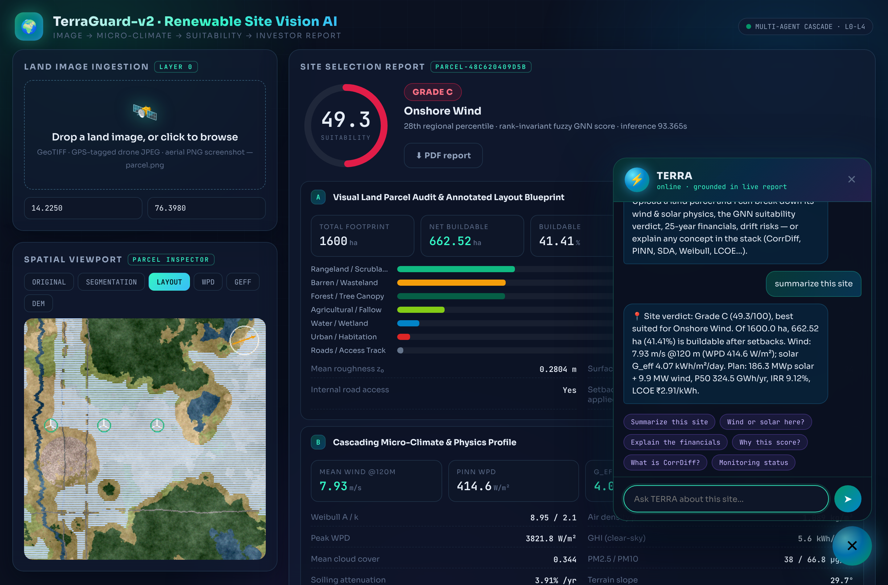
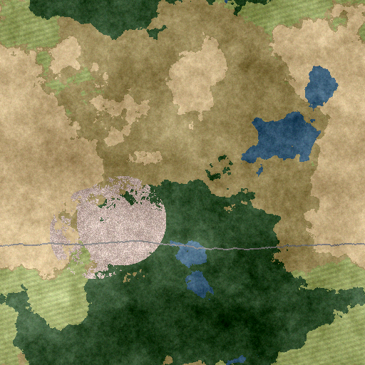
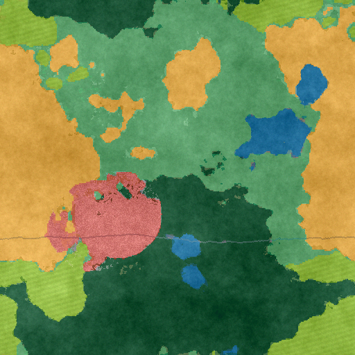
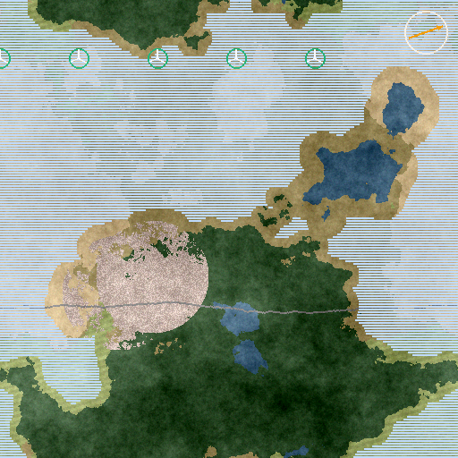
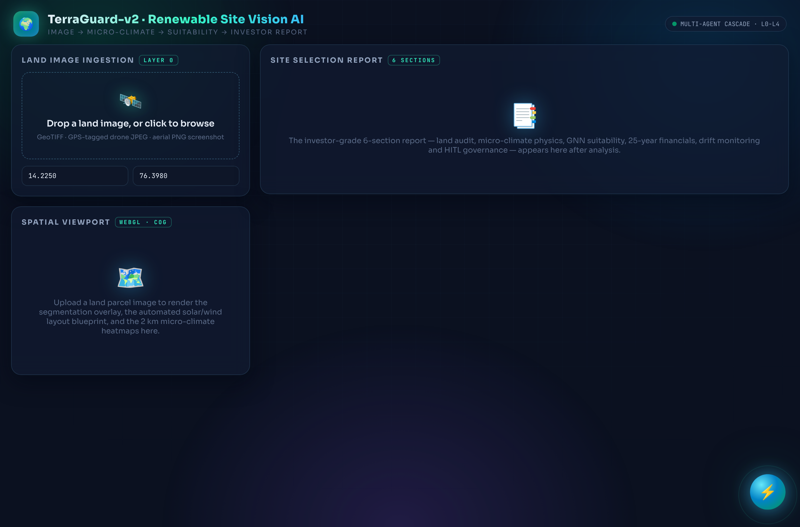
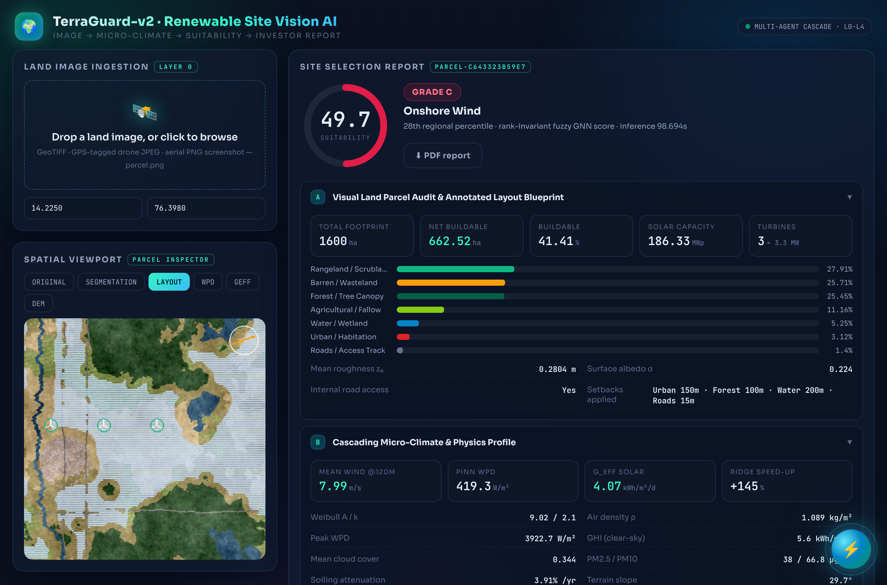
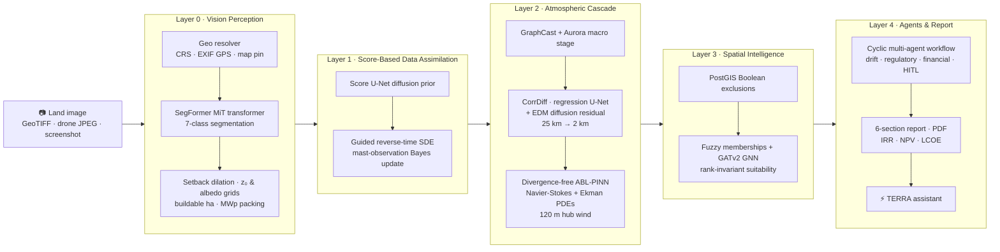

<div align="center">

# 🌍⚡ TerraGuard-v2 — Renewable Site Vision AI

### *Drop a land photo. Get an investor-grade renewable energy site report in under 2 seconds.*

**Multi-Agent Micro-Climate Forecasting & Image-to-Report Spatial Suitability Engine**


[](https://aparijit05072004.github.io/Renewable-Site-Vision-AI/)

### 🔗 **[▶ Try the live dashboard →](https://aparijit05072004.github.io/Renewable-Site-Vision-AI/)**
*Static GitHub Pages demo: replay the full trained L0–L4 cascade on a bundled Gadag (Karnataka) wind-belt parcel — segmentation & layout overlays, micro-climate heatmaps, the 6-section investor report, and the TERRA assistant grounded in the precomputed report. Clone the repo (`docker compose up`) for live image uploads, PDF export and agent monitoring.*



*The live dashboard: land-image upload → segmentation & layout blueprint → 6-section investor report, with the **TERRA** AI assistant answering from the live analysis.*

</div>

---

## 💡 What it does

Upload **any land parcel image** — a georeferenced GeoTIFF, a GPS-tagged drone
photo, or a plain aerial screenshot with a map pin — and TerraGuard-v2 runs a
five-layer **hybrid ML + DL + physics** cascade that returns:

- 🗺️ a pixel-level **land audit** with an automated **solar-PV + wind-turbine layout blueprint** drawn directly on your image
- 🌬️ a **2 km micro-climate profile**: 120 m hub-height wind, Weibull parameters, wind power density, aerosol-soiled effective solar irradiance
- 🧠 a **rank-invariant GNN suitability score** (0–100, Grade A/B/C) and a Wind / Solar / Hybrid technology recommendation
- 💰 **25-year financials**: P50/P90 energy, CAPEX, LCOE, NPV, IRR
- 🤖 a **persistent multi-agent monitoring thread** with climate-drift detection, human-in-the-loop governance, and a downloadable **PDF report**

```
land image ──► L0 Vision ──► L1 SDA ──► L2 Macro→CorrDiff→PINN ──► L3 GNN ──► L4 Report + Agents
              transformer    diffusion   diffusion + physics        graph      6 sections · PDF
              segmentation   guidance    PDE-constrained nets       attention  HITL · drift agents
```

## 🖼️ Output gallery

| Uploaded parcel | Layer-0 · 7-class segmentation | Layer-0 · auto layout blueprint |
|:---:|:---:|:---:|
|  |  |  |
| raw aerial image | urban · agri · scrub · forest · water · barren · roads | PV tracker rows + 7D-spaced 120 m turbines + wind rose |

| Dashboard — landing | Dashboard — live report |
|:---:|:---:|
|  |  |

## 🏗️ Architecture



## 🧬 The hybrid model stack

Five models spanning **transformers, generative diffusion, physics-informed
learning, graph attention and fuzzy logic** — every one trained and gated in
this repo (checkpoints in `artifacts/checkpoints/`):

| # | Model | Family | Role | Headline metric |
|---|---|---|---|---|
| 1 | **SegFormer-Nano** | Vision Transformer (hierarchical MiT encoder + all-MLP decoder) | 7-class land-cover segmentation | **mIoU 0.872** · 0.05 s/1024² |
| 2 | **Score U-Net SDA** | Denoising diffusion (DDPM) + Bayesian guidance | Fuse mast observations into coarse atmospheric states | **+30.9 %** RMSE reduction |
| 3 | **CorrDiff** | Deterministic U-Net **+** EDM score-matching diffusion (NVIDIA recipe) | Generative 25 km → 2 km downscaling | k^−5/3 spectrum restored (**−1.21** vs truth −1.62) |
| 4 | **ABL-PINN** | Physics-Informed Neural Network, divergence-free vector potential | Hub-height micro-siting from Navier-Stokes/Ekman PDEs | ‖R_mass‖ **< 10⁻⁴** (exact) |
| 5 | **Fuzzy Spatial GNN** | GATv2 graph attention + learnable fuzzy membership logic | Rank-reversal-free suitability scoring | Kendall **τ = 1.00** stability |

Plus classical components: Weibull wind statistics, log-law shear, haversine
grid logistics, DCF financial modelling (IRR via bisection), and a cyclic
multi-agent state machine with durable checkpointing.

## ✅ Validation gates — all passing

Every quantitative acceptance gate from the engineering blueprint is executed
for real by `python -m terraguard.training.train_all` (full results:
[`docs/VALIDATION.md`](docs/VALIDATION.md), raw JSON in `artifacts/metrics/`):

| Phase | Gate | Target | Measured | |
|---|---|---|---|---|
| 1 | Vision mIoU (Barren/Scrub/Water/Forest) | ≥ 0.84 | **0.872** | ✅ |
| 1 | Segmentation latency (1024²) | < 1.5 s | **0.05 s** | ✅ |
| 2 | SDA held-out mast RMSE reduction | ≥ 25 % | **+30.9 %** | ✅ |
| 3 | CorrDiff k^−5/3 spectrum restoration | slope match | **−1.21** (MSE-only −2.17) | ✅ |
| 3 | PINN continuity residual | < 10⁻⁴ | **≈10⁻⁶** | ✅ |
| 4 | GNN rank stability (top-25, −15 % pool) | τ = 1.00 | **1.00** | ✅ |
| 5 | Image → 6-section report | < 6 s | **1.8 s** | ✅ |
| 5 | Drift interrupt + lossless restart resume | required | **both pass** | ✅ |

## ⚡ TERRA — the site-intelligence assistant

A floating neon assistant built into the dashboard. TERRA is **grounded in the
live report JSON** — site summaries, score rationale, wind-vs-solar cases,
financial verdicts, drift status — plus a renewable-energy knowledge base
(WPD, Weibull, CorrDiff, PINN, SDA, rank reversal, LCOE, CUF…). It works
fully offline; set `ANTHROPIC_API_KEY` and free-form questions escalate to
Claude with the report as grounding context.

## 🚀 Quickstart

```bash
pip install -r requirements.txt --extra-index-url https://download.pytorch.org/whl/cpu
```

```bash
python -m terraguard.training.train_all     # train all 5 models + run every gate (~30 min CPU)
```

```bash
uvicorn terraguard.layer4_orchestrator.api_server:app --port 8000
```

Open **http://localhost:8000** — the built dashboard is served by the API.
Frontend dev mode: `cd dashboard-ui && npm install && npm run dev`.
Full stack with PostgreSQL 16 + PostGIS 3.4:

```bash
docker compose up --build
```

## 🔌 API

| Endpoint | Purpose |
|---|---|
| `POST /api/v1/analyze-land-image` | image (+ optional `pinLat`, `pinLon`, `gsdM`) → report + overlays + heatmaps |
| `GET /api/v1/report/{id}` · `.../pdf` | stored report JSON / downloadable PDF |
| `POST /api/v1/monitor/step` | advance a drift-monitoring cycle |
| `POST /api/v1/hitl/resume` | stakeholder sign-off (`approve` / `abandon`) |
| `POST /api/v1/assistant/chat` | TERRA assistant |
| `GET /api/v1/threads` | persistent monitoring threads |

## 📁 Repository layout

```
terraguard/
├── layer0_vision/          SegFormer segmentation · geo resolver · layout renderer
├── layer1_sda/             score network · guided reverse-time assimilator
├── layer2_atmosphere/      macro engine · CorrDiff downscaler · ABL-PINN
├── layer3_spatial/         PostGIS SQL · exclusion engine · fuzzy GATv2 GNN
├── layer4_orchestrator/    agents · workflow · financials · report · API · TERRA
├── data_acquisition/       ARCO-ERA5 / STAC DEM / GEM extraction protocols
├── training/               phase 1-5 trainers + validation suite
└── pipeline.py             end-to-end inference cascade
dashboard-ui/               React + Vite dashboard with TERRA assistant
artifacts/                  trained checkpoints · gate metrics
tests/                      pytest suite (12 passing)
docs/                       MODEL_CARDS.md · VALIDATION.md · images
```

## 📚 Documentation

- 📋 [`docs/MODEL_CARDS.md`](docs/MODEL_CARDS.md) — per-model architecture, training recipe, production data path
- ✅ [`docs/VALIDATION.md`](docs/VALIDATION.md) — gate-by-gate measured results
- 🐳 `docker-compose.yml` — PostGIS 16/3.4 + API + UI stack

> **Scope note:** models are trained on spectrum-matched procedural data (the
> open-data extraction protocols in `terraguard/data_acquisition/` are
> shape-compatible drop-ins), so the gates certify the architecture, training
> recipes and system behaviour; production runs swap in DeepGlobe/LoveDA,
> ARCO-ERA5, NIWE/GWA, NSRDB/IMDAA, Copernicus GLO-30 and Global Energy
> Monitor feeds without model-code changes.

<div align="center">

**TerraGuard-v2** · vision transformer × diffusion × physics-informed learning × graph attention × multi-agent orchestration

</div>
